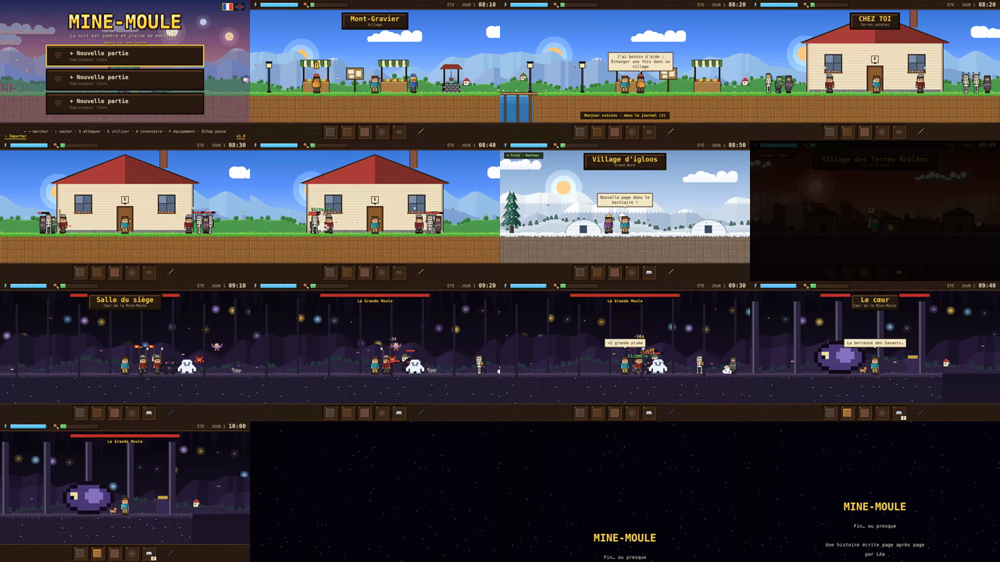

# Mine-Moule

A retro side-scrolling survival platformer in a single HTML file. French by default, English from the title screen.

Scavenge by day, build and cook at home, survive nights full of monsters. In **Story** mode, 62 quests across four lanes lead through the Far Shore, the Frozen North, the Badlands and the Sky Islands down to the Heart of the Mine-Moule. In **Survival** mode, the score is the hours you last.

## Play

Open `mine-moule.html` in Chrome (desktop or phone). No build step, no install. Saves live in the browser; export and import from the pause menu and the title screen.

| Action | Keyboard | Touch | Pad |
|---|---|---|---|
| Walk | ← → | ◀ ▶ | D-pad / stick |
| Jump / climb | ↑ | ▲ | X |
| Attack | S or X | ⚔ | R1 / R2 |
| Use | E | E | Square |
| Inventory | A | A | Circle |
| Equipment | F | F | Triangle |
| Journal | J | pause menu | Share |
| World map | M | map button | L1 (L2 / R2 zoom, right stick pans) |
| Build mode | B (arrows aim, Enter place, hold Backspace break) | tap to place | L2 (right stick aims, R2 place, hold Square break, L1 / R1 block) |
| Quick bar | 1–5 | tap slot | — |
| Full screen | P | ⛶ button | — |
| Pause | Esc | II | Options |

## Features

- Action combat with weapon damage types, armour types and a gentle setting
- Building in the wild: stone, wood, brick, web and metal binding, ladders, gates, spikes, traps, shelters that count as beds
- Reusable camp gear: a tent, a campfire and a field bench you set down and pack up anywhere
- A world map in two styles (Grandma's and Metro) with zoom, and quick travel that costs the time, energy and hunger of the trip
- Lantern → silver lantern → headlamp, whose beam lights the path at night
- 29 monsters including four bosses, and an illustrated bestiary
- Scholar's stones: maths questions at the player's grade (1–6), with a number pad and read-aloud
- A "My Story" book that writes an illustrated page for every finished quest
- 20 songs from the Kick la Banane music engine, in many arrangements

## Docs

- [Implementation plan](docs/implementation-plan.html): the original design and build plan, with the decisions behind it
- [Playtest report](docs/playtest-report/index.html): 288 simulated playthroughs of 1.14.0 by young casual first-timers and hardcore players, with ranked fixes

Open them in a browser after cloning (GitHub shows HTML files as source).

## Credits

Idea and world: Francis and family. Code, art and pages: Claude.
